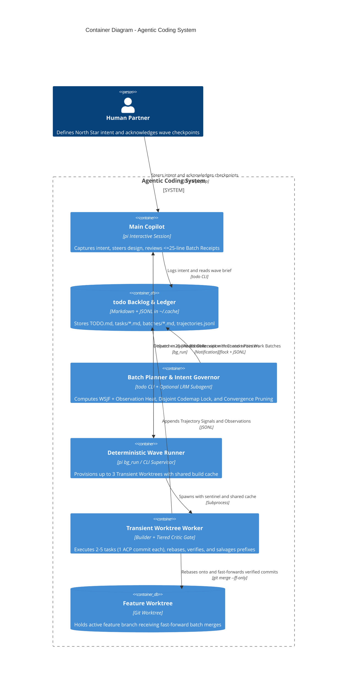
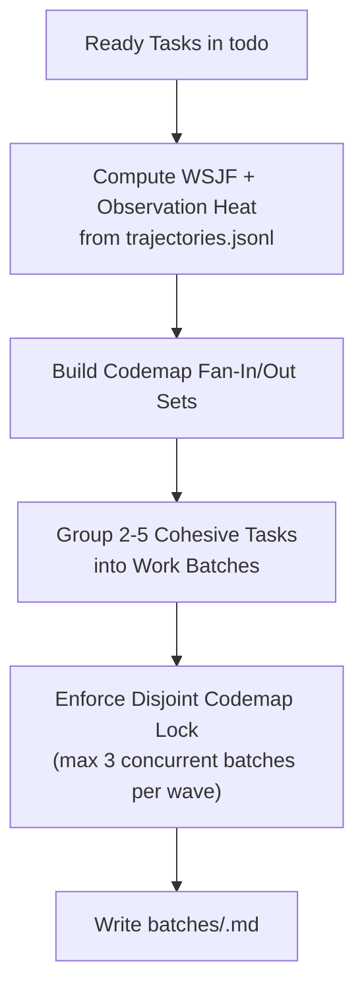
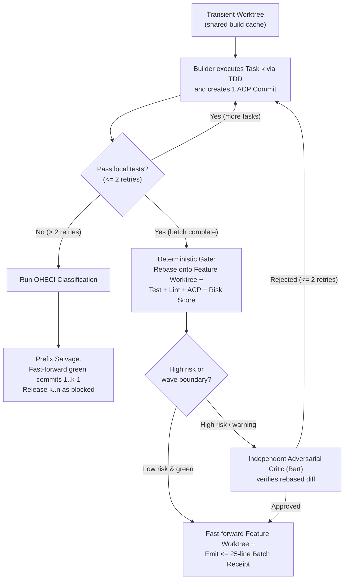
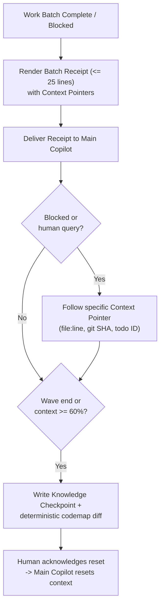
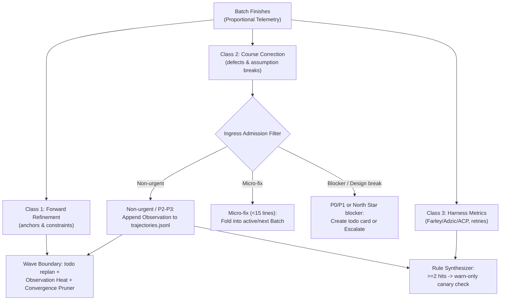

# Handoff Specification: Agentic Coding System

> **Status:** Approved (8 Grill Rounds) | **Owner:** `unop`  
> **Audience:** Engineers, Implementation Agents, Quality Agents, System Architects  
> **Scope:** Interactive `Main Copilot` (`pi`), `todo` Backlog Store, Deterministic Wave Runner, Transient Worktree Execution, Context Hygiene, and Three-Stream Learning Loop.  
> **Stance:** Long Horizon — existing `~/shalomb/springfield/` and `pi` skills are evidence to reuse selectively where they earn their keep, not fixed authority.

---

## 1. Who Reads What

| Audience | Read in this order |
| :--- | :--- |
| **Product / Human Partner** | [§2 At a Glance](#2-at-a-glance), [§3 Goal and Falsifiable Hypotheses](#3-goal-and-falsifiable-hypotheses), [§6 Anti-Goals](#6-anti-goals), [§7 Tracer-Bullet Tickets](#7-tracer-bullet-tickets) |
| **System Architect** | [§2 At a Glance](#2-at-a-glance), [§4 Architectural Seams (C4)](#4-architectural-seams-c4), [ADR-001](adr/ADR-001-copilot-deterministic-topology.md) through [ADR-007](adr/ADR-007-two-stage-intent-governor.md) |
| **Implementation Agent (Builder)** | [GLOSSARY.md](GLOSSARY.md), [§5 Spec Units](#5-spec-units), [§6 Anti-Goals](#6-anti-goals), [§7 Tracer-Bullet Tickets](#7-tracer-bullet-tickets) |
| **Quality / Verification Agent (Critic)** | [§3 Goal and Falsifiable Hypotheses](#3-goal-and-falsifiable-hypotheses), [features/batch-execution-and-merge.feature](features/batch-execution-and-merge.feature), [features/learning-and-intent-governor.feature](features/learning-and-intent-governor.feature), [features/waf-guardrails-and-recovery.feature](features/waf-guardrails-and-recovery.feature) |

---

## 2. At a Glance

| Pillar | Decision | Settled Node | Governing ADR |
| :--- | :--- | :--- | :--- |
| **Control Topology** | Interactive `Main Copilot` in `pi` + deterministic subprocess runner; zero LLM pane-polling | `control.topology` | [ADR-001](adr/ADR-001-copilot-deterministic-topology.md) |
| **State Store** | Single out-of-repo `todo` store (`~/.cache/agent-skills/todos/<repo_slug>/`) + `batches/<id>.md` + `trajectories.jsonl` | `state.backlog-store` | [ADR-002](adr/ADR-002-single-out-of-repo-todo-store.md) |
| **Wave Batching** | Deterministic `todo batch` groups 2–5 cohesive tasks (1 ACP commit per task); max 3 `Transient Worktrees` with `Disjoint Codemap Lock` and `Prefix Salvage` | `work.batching`, `waf.worktree-concurrency`, `waf.partial-batch-salvage` | [ADR-003](adr/ADR-003-cohesive-wave-batching-and-prefix-salvage.md) |
| **Verification & Merge** | `Tiered Critic Gate`: Builder self-review + deterministic rebase/test gate by default; independent Adversarial Critic on high-risk or wave boundaries | `control.topology.subagent-pipeline` | [ADR-004](adr/ADR-004-risk-tiered-critic-gate.md) |
| **Context Hygiene** | `<= 25`-line `Batch Receipt` with `Context Pointers` (`git:`, `todo:`, `file://`); wave-boundary `Knowledge Checkpoint` with `codemap diff` and human ack at 60% budget | `context.hygiene`, `waf.context-drift-guard` | [ADR-005](adr/ADR-005-context-hygiene-and-pointer-receipts.md) |
| **Learning Loop** | `Proportional Telemetry` + 3 streams (`Forward Refinement`, `Course Correction`, `Rule Synthesizer`) with $N \ge 20$ cold-start floor and warn-only canary rules | `learning.loop-mechanism`, `waf.rl-cold-start-safety` | [ADR-006](adr/ADR-006-three-stream-learning-loop.md) |
| **Intent Governance** | Two-stage `Intent Governor` (`Ingress Admission Filter` -> `Observations` -> `Observation Heat` WSJF -> `Convergence Ratio` pruner) | `learning.loop-mechanism.intent-governor` | [ADR-007](adr/ADR-007-two-stage-intent-governor.md) |

---

## 3. Goal and Falsifiable Hypotheses

The system keeps a human and a `Main Copilot` in a tight, high-signal design loop over long sessions while delegating cohesive `Work Batches` to subagents in `Transient Worktrees`. Every wave reduces uncertainty in the remaining backlog and consolidates verified atomic commits into the `Feature Worktree` without polluting the `Main Copilot` context window or causing runaway backlog bloat.

Every major architectural pillar is bound to a [Falsifiable Hypothesis](GLOSSARY.md) tested in a tracer spike before full build-out ([ADR-003](adr/ADR-003-cohesive-wave-batching-and-prefix-salvage.md) through [ADR-007](adr/ADR-007-two-stage-intent-governor.md)):

| ID | Hypothesis | Pass Threshold | Kill / Simplify Criterion |
| :--- | :--- | :--- | :--- |
| **H1** | Cohesive `Work Batch` (3 tasks in 1 `Transient Worktree`) beats 3 single-task worktree runs | $< 65\%$ total tokens and wall-clock time of 3 single-task runs | If $\ge 85\%$, drop multi-task batching and execute 1 task per worktree or sequentially in place . **2026-10-31: KILLED** (4 replicates, 2 repos, 2 models: tokens 0.68–1.94×, always slower than parallel singles at equal quality; default is now 1 task per worktree, see [ADR-003 Amendment 1](adr/ADR-003-cohesive-wave-batching-and-prefix-salvage.md#amendment-1-2026-10-31-h1-evidence)) |
| **H2** | `Batch Receipt` (`<= 25` lines) + `Context Pointers` prevent `Main Copilot` context pollution | `< 50%` context occupancy across 10 batches (~30 tasks) and `< 15%` pointer dereference rate | If dereference rate `> 40%`, inline the changed contract signature directly in the receipt . **2026-10-31: MODEL-DEPENDENT** (context ≤ 7% passes everywhere; Sonnet verifies `git:` pointers (0.32, 0.41 with asserted attestation), Gemini reads files (0.14). Fix: one-call `verify-receipt` → 1 call/receipt, 0.44× tokens. See [ADR-005 Amendment 1](adr/ADR-005-context-hygiene-and-pointer-receipts.md#amendment-1-2026-10-31-h2-evidence)) |
| **H3** | `Tiered Critic Gate` catches defects on routine batches without spawning a second LLM | $\ge 85\%$ defect catch rate on low-risk batches at $< 50\%$ review token cost | If escaped defect rate on low-risk batches `> 15%`, narrow the low-risk classifier. **2026-10-31: KILLED for `todo-navigator`** (holdout 0.63 after test hardening; classifier narrowed, see [ADR-004 Amendment 1](adr/ADR-004-risk-tiered-critic-gate.md#amendment-1-2026-10-31-tb-3-evidence)) |
| **H4** | Two-stage `Intent Governor` prevents runaway backlog inventory | `Convergence Ratio` $< 1.0$ by Wave 2; reaches 0 open P0/P1 tasks without manual cleanup | If open backlog grows monotonically across 3 waves, restrict autonomous task creation to P0 regressions only . **2026-10-31: PASSES, necessity unproven** (governed 6→3→0 open; control 6→4→4; findings rare at 3/27 runs, so both converge; see [ADR-007 Amendment 1](adr/ADR-007-two-stage-intent-governor.md#amendment-1-2026-10-31-tb-4-evidence)) |

---

## 4. Architectural Seams (C4)



---

## 5. Spec Units

### 5.1 Spec Unit 1: Deterministic Wave Batching and Disjoint Codemap Lock

**Who / When:** The `Batch Planner` (`todo batch` CLI by default; LRM subagent on ambiguity) when preparing the next execution wave from ready `todo` tasks.



**Contract:**
- The `Batch Planner` MUST compute task priority using WSJF plus `Observation Heat` from `trajectories.jsonl`.
- The `Batch Planner` MUST group between 2 and 5 ready tasks that share files or direct `codemap` module neighborhoods into a single `Work Batch`.
- The `Batch Planner` MUST enforce a `Disjoint Codemap Lock` so no two concurrent `Work Batches` in the same wave share modified files or direct `codemap` fan-out dependencies.
- The `Batch Planner` MUST run deterministically with zero LLM tokens unless a task card is flagged ambiguous or a Wave-Boundary `Course Correction` requires an LRM planning pass.

<details>
<summary>Machine-readable contract (YAML)</summary>

```yaml
unit: wave_batching
actor: Batch Planner
invariants:
  batch_size_min: 1
  batch_size_target_min: 2
  batch_size_max: 5
  max_concurrent_worktrees: 3
  disjoint_codemap_lock: true
  default_llm_passes: 0
artifacts:
  batch_card: "${XDG_CACHE_HOME}/agent-skills/todos/${repo_slug}/batches/${batch_id}.md"
```
</details>

---

### 5.2 Spec Unit 2: Work Batch Execution, Tiered Critic Gate, and Prefix Salvage

**Who / When:** The Builder subagent and `Tiered Critic Gate` inside a `Transient Worktree` during `Work Batch` execution.



**Contract:**
- The runner MUST provision each `Transient Worktree` from the `Feature Worktree` HEAD and mount or link shared dependency caches (`.venv`, `node_modules`, build cache).
- The Builder MUST create one atomic commit per task in the `Work Batch` in accordance with the Atomic Commit Protocol (ACP).
- If a task fails verification after 2 local retries, the Builder MUST run the OHECI loop and halt execution of the remaining tasks in the batch.
- When a `Work Batch` halts at task $K$ ($K > 1$), the gate MUST execute `Prefix Salvage`: rebase and fast-forward the verified commits $1 \dots K-1$ into the `Feature Worktree`, mark tasks $1 \dots K-1$ `done` in `todo`, and release tasks $K \dots N$ with the blocker `Context Pointer`.
- The `Tiered Critic Gate` MUST rebase the `Transient Worktree` onto the `Feature Worktree` and run the deterministic test and ACP suite before merge.
- The `Tiered Critic Gate` MUST spawn an independent Adversarial Critic subagent only when the batch modifies hub files, changes public API/security boundaries, tests a proposed ADR hypothesis, or closes a wave.

<details>
<summary>Machine-readable contract (YAML)</summary>

```yaml
unit: batch_execution_and_gate
actors:
  - Builder
  - Tiered Critic Gate
invariants:
  commits_per_task: 1
  commit_protocol: ACP
  max_local_retries: 2
  escalation_loop: OHECI
  prefix_salvage_on_partial_block: true
  rebase_before_verification: true
  independent_critic_triggers:
    - high_fanout_hub_file
    - public_api_or_security_path
    - proposed_adr_hypothesis
    - deterministic_gate_warning
    - wave_boundary
```
</details>

---

### 5.3 Spec Unit 3: Pointer-Rich Batch Receipts and Wave Checkpoints

**Who / When:** The runner and `Main Copilot` upon completion of each `Work Batch` and at wave or context-budget boundaries.



**Contract:**
- Every completed or blocked `Work Batch` MUST return a `Batch Receipt` of at most 25 lines to the `Main Copilot`.
- The `Batch Receipt` MUST replace inline diffs and raw logs with `Context Pointers` (`git:<sha>`, `todo:<id>`, `file:///path#L<line>`, and report URIs).
- The `Main Copilot` MUST NOT read raw subagent logs or full diffs unless a `Work Batch` blocks, an assumption breaks, or the human asks.
- At the end of each wave or when `Main Copilot` context occupancy reaches 60%, the system MUST write a `Knowledge Checkpoint` containing the North Star intent, settled architectural anchors, active backlog wave state, and a deterministic `codemap diff`.
- The `Main Copilot` MUST obtain human acknowledgement before resetting its context window from a `Knowledge Checkpoint`.

<details>
<summary>Machine-readable contract (YAML)</summary>

```yaml
unit: context_hygiene
actor: Main Copilot
invariants:
  batch_receipt_max_lines: 25
  pointer_schemes:
    - "git:"
    - "todo:"
    - "file://"
  checkpoint_triggers:
    - wave_boundary
    - context_occupancy_percent >= 60
  checkpoint_requires_codemap_diff: true
  reset_requires_human_ack: true
```
</details>

---

### 5.4 Spec Unit 4: Three-Stream Learning Loop and Two-Stage Intent Governor

**Who / When:** The `Tiered Critic Gate`, `Intent Governor`, and `Rule Synthesizer` across `Work Batch` completions and wave boundaries.



**Contract:**
- Telemetry MUST follow `Proportional Telemetry`: Tier 0 trivial batches emit zero-LLM deterministic metrics; Tier 1 standard batches add a 3-line Builder delta note; Tier 2 high-risk and wave-boundary runs execute full 3-stream pattern mining over `trajectories.jsonl`.
- The `Ingress Admission Filter` MUST fold micro-fixes ($< 15$ lines in touched files) into active batches and record non-urgent P2/P3 findings as anchored `Observations` in `trajectories.jsonl` rather than creating immediate `todo` cards.
- Severe `Course Correction` signals that invalidate an architectural assumption or the North Star MUST pause dependent batches and present a decision option to the `Main Copilot` and human.
- At each wave boundary, `todo replan` MUST add an `Observation Heat` bonus to the Cost of Delay (WSJF) of open tasks whose anchors match recurring `Observations`.
- Unassigned `Observation` clusters ($\ge 2$ occurrences across waves) MAY promote to new `todo` tasks only when the wave `Convergence Ratio` is $\le 1.0$.
- When the `Convergence Ratio` exceeds $1.0$, the `Intent Governor` MUST block standalone P2/P3 task creation, merge tasks sharing module anchors, and prune low-WSJF leaf tasks with no North Star link.
- The `Rule Synthesizer` MUST keep routing static until at least 20 cross-session trajectories exist and MUST deploy newly synthesized `ast-grep` or lint checks in warn-only canary mode until human approval.

<details>
<summary>Machine-readable contract (YAML)</summary>

```yaml
unit: learning_and_intent_governor
actors:
  - Intent Governor
  - Batch Planner
  - Rule Synthesizer
invariants:
  telemetry_tiers:
    tier_0_trivial: deterministic_only
    tier_1_standard: deterministic_plus_3_line_builder_note
    tier_2_high_risk_or_wave: full_critic_and_wave_miner
  ingress_microfix_max_lines: 15
  observation_promotion_min_occurrences: 2
  convergence_ratio_prune_threshold: 1.0
  min_trajectories_for_bandit_routing: 20
  new_synthesized_rules_mode: warn_only_canary
```
</details>

---

## 6. Anti-Goals

The implementation MUST NOT do any of the following:

1. **No LLM Pane-Polling or Process Supervision:** Never use an LLM to poll `tmux` panes, parse shell prompts, or watch PIDs. Process management is 100% deterministic.
2. **No Multi-Persona LLM Chains on Routine Batches:** Never spin up separate Planner, Builder, Critic, Miner, and Release LLM sessions for a routine low-risk batch. Default to 1 LLM pass (Builder) plus deterministic gates.
3. **No Repo-Polluting State Files:** Never commit `TODO.md`, `FEEDBACK.md`, or `.todos/issues.db` into target code repositories. All backlog cards, batch manifests, and `trajectories.jsonl` stay in `~/.cache/agent-skills/todos/<repo_slug>/`.
4. **No Raw Log or Diff Dumps in the Main Copilot:** Never stream full subagent transcripts, test logs, or git diffs into the `Main Copilot` context window by default; always return a `<= 25`-line `Batch Receipt` with `Context Pointers`.
5. **No Unfiltered Backlog Creation from Subagents:** Subagents must never create standalone P2/P3 `todo` tasks directly without passing the `Ingress Admission Filter` and `Convergence Ratio` check.
6. **No Un-Gated Hard Auto-Rules or Cold-Start Bandits:** Never let a synthesized lint/`ast-grep` rule fail a build without canary verification and human promotion, and never update routing weights on fewer than 20 recorded trajectories.

---

## 7. Tracer-Bullet Tickets

Execute the four falsification spikes (**TB-1** to **TB-4**) before building the full wave runner:

1. **TB-1 (Spike H1 — Cohesive Work Batch vs. Single-Task Runs):**
   - *Goal:* Benchmark a 3-task cohesive `Work Batch` (3 ACP commits in 1 `Transient Worktree`) against 3 isolated single-task worktree runs on a real repo backlog.
   - *Verification:* Confirm total token spend and wall-clock time are $< 65\%$ of the 3 single-task runs.
2. **TB-2 (Spike H2 — `<= 25`-Line `Batch Receipt` & `Context Pointers`):**
   - *Goal:* Define the `Batch Receipt` validator and URI/anchor pointer format (`git:`, `todo:`, `file://`) and replay 10 batch completions into a `Main Copilot` session.
   - *Verification:* Confirm `Main Copilot` context stays $< 50\%$ with $< 15\%$ pointer dereferences.
3. **TB-3 (Spike H3 — Deterministic Gate + `Prefix Salvage`):**
   - *Goal:* Build the deterministic rebase, test, ACP-commit, and risk-score gate with `Prefix Salvage` when task $K$ fails after green commits $1 \dots K-1$.
   - *Verification:* Run `features/batch-execution-and-merge.feature` and `features/waf-guardrails-and-recovery.feature` scenarios.
4. **TB-4 (Spike H4 — `trajectories.jsonl`, `Observation Heat`, and `Intent Governor`):**
   - *Goal:* Extend `todo` with `trajectories.jsonl` `Observation` logging, `Observation Heat` WSJF bonuses in `todo replan`, and `Convergence Ratio` pruning.
   - *Verification:* Run `features/learning-and-intent-governor.feature` scenarios across a simulated 3-wave backlog.
5. **TB-5 (Core — Deterministic `todo batch` + `Disjoint Codemap Lock`):**
   - *Goal:* Add `todo batch` subcommand combining WSJF waves with `codemap` fan-in/fan-out disjointness (max 3 concurrent batches).
6. **TB-6 (Core — Wave Checkpoint + `codemap diff` + `Rule Synthesizer` Canary):**
   - *Goal:* Implement wave-boundary `Knowledge Checkpoint` generation with `codemap diff` and warn-only canary rule synthesis.

---

## 8. Open Decisions

None. All 21 decision nodes in [decision-tree.md](decision-tree.md) are `settled`.

---

## 9. Links

- **Decision Tree:** [decision-tree.md](decision-tree.md)
- **Domain Glossary:** [GLOSSARY.md](GLOSSARY.md)
- **ADRs (1 Single Architectural Decision per Document, Y-Statement + Matrix):**
  - [ADR-001: Interactive Main Copilot with Deterministic Subagent Lifecycle Supervision](adr/ADR-001-copilot-deterministic-topology.md)
  - [ADR-002: Out-of-Repo Single Backlog Store and Trajectory Ledger (`todo`)](adr/ADR-002-single-out-of-repo-todo-store.md)
  - [ADR-003: Cohesive Wave Batching with Disjoint Codemap Locks and Prefix Salvage](adr/ADR-003-cohesive-wave-batching-and-prefix-salvage.md)
  - [ADR-004: Risk-Tiered Critic Gate with Unified Rebase-Before-Verify](adr/ADR-004-risk-tiered-critic-gate.md)
  - [ADR-005: Context Hygiene via Pointer-Rich Batch Receipts and Wave Checkpoints](adr/ADR-005-context-hygiene-and-pointer-receipts.md)
  - [ADR-006: Three-Stream Learning Loop with Cold-Start Guards](adr/ADR-006-three-stream-learning-loop.md)
  - [ADR-007: Two-Stage Intent Governor (Ingress Observations, Observation Heat WSJF, and Convergence Pruner)](adr/ADR-007-two-stage-intent-governor.md)
- **Acceptance Scenarios (BDD):**
  - [features/batch-execution-and-merge.feature](features/batch-execution-and-merge.feature)
  - [features/learning-and-intent-governor.feature](features/learning-and-intent-governor.feature)
  - [features/waf-guardrails-and-recovery.feature](features/waf-guardrails-and-recovery.feature)
- **Round Replies:** [rounds/](rounds/) (`round-01.md` through `round-08.md`)
