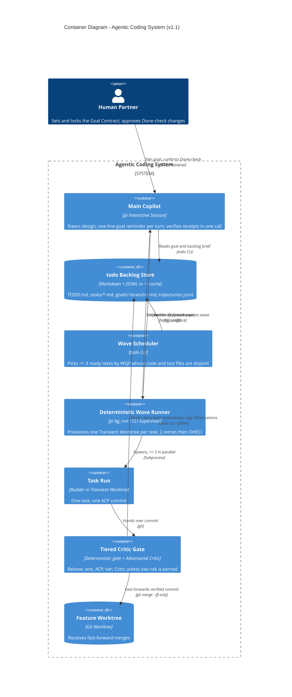
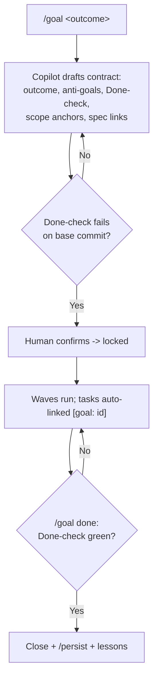
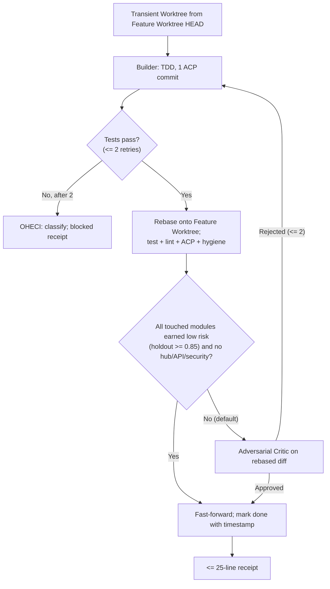

# Handoff Specification: Agentic Coding System

> **Status:** Revising, v1.1.0 (v1.0 approved after 8 grill rounds; v1.1 revised after H1–H4 falsification, 5 more rounds in [rounds/v1.1/](rounds/v1.1/)) | **Owner:** `unop`
> **Audience:** Engineers, Implementation Agents, Quality Agents, System Architects
> **Scope:** Interactive `Main Copilot` (`pi`), Goal Contract (`/goal`), `todo` Backlog Store, Deterministic Wave Runner, single-task Transient Worktrees, Tiered Critic Gate, Context Hygiene, and the Learning Loop.
> **Stance:** Long horizon. Nodes reopen only where evidence touched them; `control.topology` stands.

**What changed in v1.1.** Multi-task Work Batches are gone (H1). Every Task Run is one task in one worktree. The Critic runs by default until a module earns low risk (H3). Trust in receipts comes from `verify-receipt`, not prose (H2). Findings are verified before they are folded (H4). The North Star is now stored and checkable (`/goal`, ADR-008/009). The reasons live in the ADR amendments; this document describes only the current design.

---

## 1. Who Reads What

| Audience | Read in this order |
| :--- | :--- |
| **Product / Human Partner** | [§2](#2-at-a-glance), [§3](#3-goal-and-falsifiable-hypotheses), [§5.1](#51-spec-unit-1-goal-contract-and-done-check), [§6](#6-anti-goals), [§7](#7-tracer-bullet-tickets) |
| **System Architect** | [§2](#2-at-a-glance), [§4](#4-architectural-seams-c4), ADR-001 to ADR-009, [§8](#8-commitment-ledger) |
| **Implementation Agent (Builder)** | [GLOSSARY.md](GLOSSARY.md), [§5](#5-spec-units), [§6](#6-anti-goals), [§7](#7-tracer-bullet-tickets) |
| **Quality / Verification Agent (Critic)** | [§3](#3-goal-and-falsifiable-hypotheses), [features/](features/) |

---

## 2. At a Glance

| Pillar | Decision | Governing ADR | Evidence |
| :--- | :--- | :--- | :--- |
| **Intent** | One Goal Contract per branch, with a Done-check locked before work starts | [ADR-008](adr/ADR-008-branch-scoped-goal-contract.md), [ADR-009](adr/ADR-009-precommitted-done-check-gates-closure.md) (+Am. 1), [ADR-010](adr/ADR-010-goal-lock-tamper-evidence-on-private-ref.md) | H5 pending |
| **Control Topology** | Interactive `Main Copilot` in `pi` + deterministic subprocess runner; no LLM pane-polling | [ADR-001](adr/ADR-001-copilot-deterministic-topology.md) | Used by H4 runner |
| **State Store** | Single out-of-repo `todo` store: `TODO.md`, `tasks/`, `goals/`, `trajectories.jsonl` | [ADR-002](adr/ADR-002-single-out-of-repo-todo-store.md) | Gap: no closure timestamps (TB-8) |
| **Wave Scheduling** | One task per Transient Worktree; ≤ 3 in parallel; Disjoint Codemap Lock over code **and test** files | [ADR-003 Am. 1](adr/ADR-003-cohesive-wave-batching-and-prefix-salvage.md#amendment-1-2026-10-31-h1-evidence) | H1 killed batching |
| **Verification & Merge** | Rebase first, then deterministic gate; Critic by default; deterministic-only earned at holdout ≥ 0.85 | [ADR-004 Am. 1](adr/ADR-004-risk-tiered-critic-gate.md#amendment-1-2026-10-31-tb-3-evidence) | H3 killed for todo-navigator |
| **Context Hygiene** | ≤ 25-line receipt with Context Pointers; one `verify-receipt` call per receipt; no prose attestation | [ADR-005 Am. 1](adr/ADR-005-context-hygiene-and-pointer-receipts.md#amendment-1-2026-10-31-h2-evidence) | H2: ctx ≤ 7%; Sonnet C pending |
| **Learning & Governance** | Findings verified before folding; non-urgent findings logged as Observations; pruning and three-stream learning accepted, unbuilt | [ADR-006](adr/ADR-006-three-stream-learning-loop.md), [ADR-007 Am. 1](adr/ADR-007-two-stage-intent-governor.md#amendment-1-2026-10-31-tb-4-evidence) | H4 passes; necessity unproven |

---

## 3. Goal and Falsifiable Hypotheses

The system keeps a human and a `Main Copilot` in a tight design loop over long sessions, against a stored, checkable goal. It delegates single tasks to parallel Builders in Transient Worktrees and lands verified atomic commits on the Feature Worktree, without polluting the Copilot's context or growing the backlog without limit. Work stops when the goal's Done-check is green.

| ID | Hypothesis | Pass | Kill / Simplify | Status (2026-11-01) |
| :--- | :--- | :--- | :--- | :--- |
| **H1** | A 3-task batch in one worktree beats 3 single-task runs | < 65% tokens and time | ≥ 85%: 1 task per worktree | **Killed.** 1 task per worktree adopted ([ADR-003 Am. 1](adr/ADR-003-cohesive-wave-batching-and-prefix-salvage.md#amendment-1-2026-10-31-h1-evidence)) |
| **H2** | ≤ 25-line pointer receipts keep the Copilot lean | < 50% context; re-scoped to calls per receipt and tokens vs plain receipts | > 1 verification call per receipt alongside `verify-receipt`: gate-signed result in receipt | **Context passes; `verify-receipt` passes on Gemini; Sonnet pending** |
| **H3** | The deterministic gate catches low-risk defects without a second LLM | ≥ 85% holdout catch rate | Escaped > 15%: narrow low-risk | **Killed for todo-navigator.** Critic by default ([ADR-004 Am. 1](adr/ADR-004-risk-tiered-critic-gate.md#amendment-1-2026-10-31-tb-3-evidence)) |
| **H4** | The Intent Governor prevents runaway backlog | Ratio < 1.0 by wave 2; 0 open P0/P1 | Monotonic growth over 3 waves | **Passes; necessity unproven.** Re-test with high-finding work, ≥ 5 waves |
| **H5** | With `/goal` active, sessions stop within 1 turn of a green Done-check, and < 10% of commits fall outside the Scope Anchors | Both, vs sessions without `/goal` | No difference: downgrade `/goal` to a notes file | **New, untested** ([ADR-009](adr/ADR-009-precommitted-done-check-gates-closure.md)) |

Evidence: `~/shalomb/agentic-falsify/runs/FINDINGS.md`.

---

## 4. Architectural Seams (C4)



---

## 5. Spec Units

### 5.1 Spec Unit 1: Goal Contract and Done-check

**Who / When:** The Human Partner and Main Copilot, at the start of work on a branch and at its end.



**Contract:**
- Each branch MUST have at most one active Goal Contract, stored at `${XDG_CACHE_HOME:-~/.cache}/agent-skills/todos/<repo_slug>/goals/<branch-slug>.md`.
- A Goal Contract MUST contain an outcome and a Done-check. It SHOULD contain anti-goals, Scope Anchors and spec links.
- A Done-check MUST fail on the base commit before it can be locked. Only the Human Partner can lock it.
- A locked Done-check MUST change only with Human Partner approval. Each change is recorded with who, when and why.
- `/goal done` MUST refuse to close while the Done-check fails. On close it MUST write a `/persist` hand-off and a lessons capture.
- A goal with no command check MAY use a human-confirm check. Its closure MUST be recorded as `closed_by: assertion`.
- Tasks created on a branch with an active goal MUST carry `[goal: <id>]`.
- Each turn, the Copilot's prompt MUST carry a one-line reminder (`Goal: <id> <outcome>; run /goal to refresh`), not the full contract.
- At session start, a goal whose branch is merged or deleted MUST be flagged for the human to close or drop.
- **Lock integrity (ADR-009 Amendment 1, ADR-010):**
  - A command goal MUST have at least one Outcome Check; the human marks it at lock.
  - `/goal lock` MUST refuse when the base failure looks environmental (exit 126/127, `command not found`, `ModuleNotFoundError`, `ImportError`), unless the human types the goal id.
  - A Weakening Change MUST be approved only by typing the goal id; strengthening changes, lock and close stay yes/no.
  - Every lock and approved change MUST commit a hash of the done-check to the private ref `refs/goals/<branch-slug>` (never pushed). `/goal done` MUST refuse when the current check's hash differs from the ref tip.
  - Lock, change, close and drop MUST each append one event to `trajectories.jsonl`.
- `/goal` is opt-in. The agent MAY suggest it only when the work spans more than one task.
- **Drafting (ADR-011):**
  - Before drafting, the agent MUST run Discovery and report *already true*, *partly true* or *not there*. Each claim cites a path and a command.
  - The agent MAY ask at most 2 questions before drafting, and only on a gap (Owning Repo or path unknown, no observable done, outcome already true).
  - If the Owning Repo is not the current repo, the agent MUST propose starting the goal there. It MUST NOT start that goal itself.
  - On every save, `/goal` MUST run Draft Lint: static, warn only, 4 rules (missing command or script, anchor outside the repo, anchor under an install dir, shared branch). No draft command runs before review.
  - `/goal` MUST print a Review Card that ends with one next-step line, and MUST show the injected draft prompt as one quiet line.
  - On the default or a shared branch, `/goal` MUST warn and offer a worktree.

<details>
<summary>Machine-readable contract (YAML)</summary>

```yaml
unit: goal_contract
actors: [Human Partner, Main Copilot]
invariants:
  goals_per_branch_max: 1
  store: "${XDG_CACHE_HOME}/agent-skills/todos/${repo_slug}/goals/${branch_slug}.md"
  required_fields: [outcome, done_check]
  optional_fields: [anti_goals, scope_anchors, spec_links]
  lock_requires: [fails_on_base_commit, human_confirmation]
  change_requires: human_approval
  close_requires: done_check_green
  close_actions: [persist_handoff, lessons_capture]
  fallback_check: human_confirm   # recorded as closed_by: assertion
  task_link: auto
  prompt_injection: one_line_reminder
  outcome_check_required: true          # human marks it at lock
  env_failure_lock: refuse_unless_typed_id
  weakening_change_confirm: typed_goal_id
  tamper_ref: "refs/goals/${branch_slug}"  # hash of done-check per lock/approve; compared at close
  events: [goal_locked, goal_changed, goal_closed, goal_dropped]
  suggest_when: "work spans > 1 task"
artifacts:
  goal_card: "goals/${branch_slug}.md"
```
</details>

---

### 5.2 Spec Unit 2: Wave Scheduling and Disjoint Codemap Lock

**Who / When:** The Wave Scheduler (`todo batch`), before each wave.

**Contract:**
- The Wave Scheduler MUST pick at most 3 ready tasks per wave, ordered by WSJF.
- No two tasks in a wave MAY share a modified file, a test file, or direct `codemap` fan-out (ADR-003 Amendment 1).
- The Wave Scheduler MUST be deterministic and use zero LLM tokens.
- Each task runs alone in its own Transient Worktree. Tasks are never packed together.

<details>
<summary>Machine-readable contract (YAML)</summary>

```yaml
unit: wave_scheduling
actor: Wave Scheduler
invariants:
  tasks_per_worktree: 1
  max_parallel_task_runs: 3
  ordering: wsjf
  disjoint_over: [modified_files, test_files, codemap_fanout_1]
  llm_passes: 0
```
</details>

---

### 5.3 Spec Unit 3: Task Run and Tiered Critic Gate

**Who / When:** The Builder in a Transient Worktree, then the Tiered Critic Gate.



**Contract:**
- The runner MUST create each Transient Worktree from Feature Worktree HEAD and share dependency caches.
- The Builder MUST produce exactly one ACP commit per task.
- After 2 failed local retries, the Builder MUST stop, run OHECI, and return a blocked receipt with a pointer to the failing hypothesis.
- The gate MUST rebase onto Feature Worktree HEAD before verification.
- The Adversarial Critic MUST review every Task Run unless every touched module has a recorded holdout mutation score ≥ 0.85 and no hub, public API or security path is touched. Unmeasured modules count as high risk.
- The Feature Worktree MUST accept only `git merge --ff-only`.
- A merged task MUST be marked done in `todo` with a closure timestamp.

<details>
<summary>Machine-readable contract (YAML)</summary>

```yaml
unit: task_run_and_gate
actors: [Builder, Tiered Critic Gate]
invariants:
  commits_per_task: 1
  commit_protocol: ACP
  max_local_retries: 2
  escalation_loop: OHECI
  rebase_before_verification: true
  critic_default: true
  critic_skip_requires:
    all_modules_holdout_min: 0.85
    no_paths: [hub, public_api, security]
  unmeasured_module_tier: 2
  merge: ff_only
  closure_timestamp: required
```
</details>

---

### 5.4 Spec Unit 4: Receipts and verify-receipt

**Who / When:** The runner and Main Copilot, when each Task Run ends.

**Contract:**
- Every Task Run MUST return a Batch Receipt of at most 25 lines, with Context Pointers (`git:`, `todo:`, `file://`) instead of diffs or logs.
- A receipt MUST NOT carry prose attestations such as "verified by gate".
- The Copilot MUST verify a receipt with one `verify-receipt <receipt>` call. It follows a pointer only for content it needs, such as reviewing an escalated diff.
- *Accepted, unbuilt:* Knowledge Checkpoint at wave end or 60% context, with `codemap diff` and human acknowledgement. **Build trigger:** Copilot context exceeds 30% in a real session (H2 peak was 7%).

<details>
<summary>Machine-readable contract (YAML)</summary>

```yaml
unit: receipts
actor: Main Copilot
invariants:
  receipt_max_lines: 25
  pointer_schemes: ["git:", "todo:", "file://"]
  prose_attestation: forbidden
  verification: one_verify_receipt_call
accepted_unbuilt:
  knowledge_checkpoint: {trigger: "copilot context > 30% in a real session"}
```
</details>

---

### 5.5 Spec Unit 5: Findings, Observations and Learning

**Who / When:** The gate and runner when a Builder reports a finding; the scheduler at wave boundaries.

**Contract:**
- Before a finding is folded into a task or promoted, the runner MUST run one deterministic check where one exists (for example the command the Builder cites). An unverified finding MUST be logged only as an Observation.
- Verified micro-fixes (< 15 lines in touched files) MAY fold into the next task on the same anchor. Verified P0/P1 findings or goal blockers become tasks or escalate to the human. Everything else is logged as an Observation in `trajectories.jsonl`.
- A finding that breaks a goal's anti-goal or outcome MUST pause dependent tasks and go to the human.
- *Accepted, unbuilt:* Observation Heat WSJF bonus, Convergence Ratio pruning, three-stream learning (Forward Refinement, Rule Synthesizer), bandit routing with N ≥ 20 cold-start floor, warn-only canary rules. **Build trigger:** the H4 re-test (high-finding work, ≥ 5 waves) shows the control arm diverging.

<details>
<summary>Machine-readable contract (YAML)</summary>

```yaml
unit: findings
actors: [Tiered Critic Gate, Wave Runner]
invariants:
  verify_before_fold: true
  unverified_finding: observation_only
  microfix_max_lines: 15
  goal_break: pause_and_escalate
accepted_unbuilt:
  observation_heat: {trigger: "H4 re-test diverges"}
  convergence_pruning: {trigger: "H4 re-test diverges"}
  three_stream_learning: {trigger: "H4 re-test diverges"}
  rule_synthesizer: {trigger: ">= 20 trajectories and a recurring pattern", mode: warn_only_canary}
```
</details>

---

## 6. Anti-Goals

The implementation MUST NOT:

1. **Poll with an LLM.** No LLM watches `tmux` panes, shell prompts or PIDs.
2. **Pack tasks.** No multi-task Work Batches in one worktree (H1).
3. **Assume low risk.** No module skips the Critic without a recorded holdout score ≥ 0.85 (H3).
4. **Assert trust.** No prose attestations in receipts; trust comes from `verify-receipt` (H2).
5. **Fold unverified findings.** No finding becomes work without a deterministic check, where one exists (H4).
6. **Pollute repositories.** No `TODO.md`, goal files or ledgers in target repos (ADR-002).
7. **Dump logs into the Copilot.** No raw transcripts, test logs or diffs by default.
8. **Let the agent move the goal.** No change to a locked Done-check without human approval (ADR-009).
9. **Build ahead of evidence.** No accepted-unbuilt mechanism before its build trigger is met.

---

## 7. Tracer-Bullet Tickets

| Ticket | Goal | Status |
| :--- | :--- | :--- |
| TB-1 (H1) | Batch vs single-task runs | **Done** — killed |
| TB-2 (H2) | Receipts and pointers | **Done** — context passes; `verify-receipt` built |
| TB-3 (H3) | Deterministic gate | **Done** — killed for todo-navigator; gate built in `agentic-falsify` |
| TB-4 (H4) | Wave runner and governor | **Done** — passes; necessity unproven |
| TB-5 | `todo batch` as Wave Scheduler (≤ 3 disjoint single tasks; test files included) | Open |
| TB-6 | Knowledge Checkpoint | Accepted, unbuilt (trigger in §5.4) |
| TB-7 | `/goal`: Goal Contract, lock, fail-first, closure gate, reminder | **Built, merged, live** |
| TB-7b | `/goal` lock integrity: Outcome Check marking, env-failure refusal, typed weakening, `refs/goals` tamper hash, events, suggestion line | **Built, merged, live** |
| TB-7c | `/goal` drafting UX: Discovery, gap questions, Draft Lint, Review Card, shared-branch worktree offer; replay + kill rule (ADR-011) | Open — **next** |
| TB-8 | Store shared across worktrees, `created`, `[goal:]` link, `done_at` on all closures, `brief.goal` | **Built, merged** |
| RT-1 | Re-test H2 variant C on Sonnet (`VERIFY=1 MODEL=<sonnet> spikes/h2/run.sh`) | Pending quota |
| RT-2 | Re-test H4 with review-task seeds, ≥ 5 waves (`spikes/h4/seeds-review.txt`) | Pending |
| H5 | Score `/goal` sessions vs sessions without it | After TB-7 |

**Build order:** TB-7c, then the H5 scorer in `agentic-falsify`, then TB-5.

---

## 8. Commitment Ledger

| Node | Status |
| :--- | :--- |
| `control.topology`, `merge-authority`, `state.backlog-store`, `context.hygiene` | Stands |
| `waf.worktree-concurrency` | Stands, widened to test files |
| `batch-planner` | Amended: Wave Scheduler |
| `pointer-contract` | Amended: `verify-receipt`, no attestation |
| ADR-007 admission filter | Amended: verify before fold |
| `subagent-pipeline` | Inverted: Critic by default |
| `work.batching` | Invalidated |
| `waf.partial-batch-salvage`, batch cards | Moot |
| `retry-escalation` | Kept; built with the runner |
| Checkpoint trigger, drift guard, three-stream learning, Rule Synthesizer, cold-start safety, governor pruning | Accepted, unbuilt |
| `intent.north-star` | New: ADR-008, ADR-009 (+Am. 1), ADR-010 |

Full tree: [decision-tree.md](decision-tree.md).

---

## 9. Open Decisions

None blocking. Pending evidence: RT-1, RT-2, H5.

Raised by the 2026-11-02 appraisals and not yet decided (tracked in [decision-tree.md](decision-tree.md)): Outcome Checks run on a realistic input, the Critic is grounded in the raw outcome, command labels by kind (outcome, quality), an uncovered-scenario report at lock, typed spec links, goal hierarchy.

---

## 10. Links

- [decision-tree.md](decision-tree.md), [GLOSSARY.md](GLOSSARY.md)
- ADRs: [001](adr/ADR-001-copilot-deterministic-topology.md), [002](adr/ADR-002-single-out-of-repo-todo-store.md), [003](adr/ADR-003-cohesive-wave-batching-and-prefix-salvage.md), [004](adr/ADR-004-risk-tiered-critic-gate.md), [005](adr/ADR-005-context-hygiene-and-pointer-receipts.md), [006](adr/ADR-006-three-stream-learning-loop.md), [007](adr/ADR-007-two-stage-intent-governor.md), [008](adr/ADR-008-branch-scoped-goal-contract.md), [009](adr/ADR-009-precommitted-done-check-gates-closure.md), [010](adr/ADR-010-goal-lock-tamper-evidence-on-private-ref.md), [011](adr/ADR-011-discovery-before-goal-draft.md)
- Scenarios: [goal-contract](features/goal-contract.feature), [batch-execution-and-merge](features/batch-execution-and-merge.feature), [learning-and-intent-governor](features/learning-and-intent-governor.feature), [waf-guardrails-and-recovery](features/waf-guardrails-and-recovery.feature)
- Rounds: [rounds/](rounds/) (v1.0), [rounds/v1.1/](rounds/v1.1/), [rounds/goal-v2/](rounds/goal-v2/), [rounds/goal-ux/](rounds/goal-ux/)
- Evidence: `~/shalomb/agentic-falsify/runs/FINDINGS.md`
