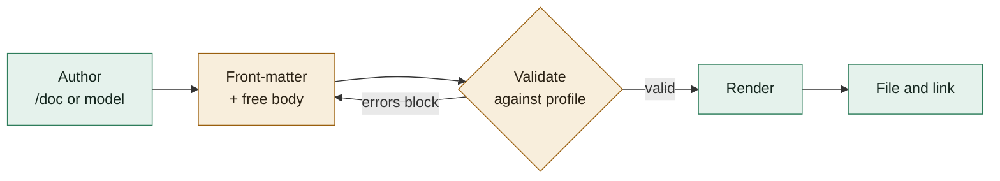

# /doc is built, but only six of ten capabilities are in use and documents still vary in shape

**Owner:** dotfiles maintainer · **Status:** Draft, at risk · **Period:** 14 Nov 2026 · **Data to:** 14 Nov 2026

**In one sentence:** The /doc epic has all ten capabilities written and tested, but only six can be reached from a command, and documents still vary in shape because the model writes them freehand, so we ask for agreement on one short step: a fixed document frame.

::: kpis
- **10 of 10** capabilities built and tested — 125 doc tests pass, none fail
- **6 of 10** reachable from a command or the published page — 4 are libraries nothing calls
- **2 of 10** have a design record — the other 8 rest on one vision note
- **1 step** to consistent documents — fixed frame, free body [ask]
:::

::: spine
- **Today** /doc renders well, but the model writes freehand, so two documents on the same subject can look and read very differently.
- **So** a reader cannot trust the shape: the manager's manager and the team get what the model happened to write.
- **Instead** the model fills a fixed frame (title, ask, takeaways, decisions, risks, sources) and writes the argument freely beneath it.
- **We ask** for agreement to build that frame for `report` first, before wiring the four unreached capabilities.
:::

## Takeaways

1. All ten capabilities exist and the doc test suite is green (125 pass, 0 fail), but only six are reachable by a user ([§1](#where))[^1].
2. The status "delivered" was wrong: four capabilities are tested libraries with no caller and eight have no design record ([§2](#gaps)).
3. The biggest risk is inconsistent output, because shape depends on what the model writes on the day ([§3](#risks)).
4. We recommend one small step first, a validated report frame, and about five further steps after it ([§4](#path))[^2].

## 1. Where we are against the vision {#where}

The vision names ten capabilities. Each moves through four stages: specified, built, wired to a command, and proven in real use. Built is complete; wiring and specification lag; proof in real use has not been measured.

::: bars
- Built and tested: 100%
- Wired to a command or the page: 60%
- Has a design record: 20%

Share of the ten capabilities at each stage. Proof in real use is not yet measured, so it is not shown.
:::

| # | Capability | Specified | Built | Wired |
|---|---|---|---|---|
| 1 | Search page | yes | yes | yes |
| 2 | `doc` CLI and navigator skill | deferred | yes | yes |
| 3 | Scratch store and promote | yes | yes | yes |
| 4 | Dossiers | deferred | yes | **no** |
| 5 | Adaptive navigation | no | yes | yes |
| 6 | Embedded provenance | no | yes | yes |
| 7 | Meeting capture, zero git taint | no | yes | **no** |
| 8 | Habit-aware ranking | no | yes | **no** |
| 9 | Brand isolation | no | yes | yes |
| 10 | Epic dashboards | no | yes | **no** |

"Wired" means a non-test file imports the module. We checked imports and did not exercise each command by hand.

## 2. Four capabilities are libraries nothing calls, and eight have no design record {#gaps}

Wiring is the visible gap. The quieter one is that capabilities 5 to 10 were built from a single paragraph each in the vision note, so the intent lives only in the code. In SAFe terms we shipped enablers without the epic's hypothesis and acceptance criteria, which is cheap to fix now and expensive once other things depend on them.

[CHECK — brand isolation is marked wired, but the vision asks us to verify that corporate styles never reach personal or open source documents; no test covers it yet.]

## 3. Risks, with an owner and a response {#risks}

Each risk is classed the way a program board would: Resolved, Owned, Accepted or Mitigated (ROAM).

| Risk | Impact | ROAM | Response | Owner |
|---|---|---|---|---|
| Output shape varies because the model writes freehand | Readers lose trust; rework before sharing upward | Owned | Fixed report frame, validated before filing ([§4](#path)) | maintainer |
| Status overstated the work ("delivered") | Wrong decisions about what to build next | Mitigated | Roadmap now tracks "wired"; status reset | maintainer |
| Corporate styling reaches a personal document | Brand and confidentiality breach | Owned | One brand resolver plus a test; today two mechanisms exist | maintainer |
| Eight capabilities have no design record | Rework, or the wrong thing wired | Owned | One decision round on five open questions | maintainer |
| Live capture needs a write-back path, against the no-server stance | Capability may not be buildable as imagined | Accepted until decided | Decide capture shape before building | maintainer |
| Skills sit on unmerged branches | The model may not find the right instructions | Owned | Merge order agreed, then push [OPEN — decide-by date] | maintainer |

## 4. The path from here {#path}

The next step is the smallest one that changes what a reader sees. Everything after it either removes a risk or wires an existing library.

**Notice:** the green steps exist today; the two amber steps are the next increment.

| Step | What it gives | Size | Depends on |
|---|---|---|---|
| 1. Report validator | Bad frames are refused with a clear reason | Small | none |
| 2. Other four profiles | Same guarantee for decision, status, workshop, deck | Medium | 1 |
| 3. Wire into `doc_publish` | Both /doc and the model get the checks | Small | 1 |
| 4. `doc_profile` tool | The model fetches the same skeleton a person gets | Small | 3 |
| 5. Render from the frame, fix title escaping | Masthead and takeaways look the same every time | Medium | 3 |
| 6. Wire dossiers, ranking, capture, dashboards | The four unreached capabilities | Large | decision round |

Sizes are relative and are an [assumption]; we have not estimated them in days.

**Definition of done** for steps 1 to 3: a report with a missing ask, or a takeaway that points at no section or source, is refused with an error naming the field; a valid report still publishes; the doc tests stay green.

## 5. Decisions and asks {#asks}

::: decision
### Do we build the fixed report frame before wiring the other four capabilities?
- **Id:** D1
- **Recommend:** Yes, steps 1 to 3 first; it removes the largest risk and is small.
- **Owner:** maintainer
- **Decide by:** [OPEN — date]
- **Blocks:** steps 4 to 6
:::

::: decision
### Do we hold wiring of the four libraries until each has a design record?
- **Id:** D2
- **Recommend:** Yes; one decision round first, so we wire what was intended.
- **Owner:** maintainer
- **Decide by:** [OPEN — date]
- **Blocks:** step 6
:::

## Method and limits

Figures come from the roadmap table, the doc test run on 14 Nov 2026 and a search for which files import each module. "Reachable" was checked by imports, not by running every command. Stage percentages count capabilities, not effort, so they say how many are at a stage, not how much work remains.

## Sources

[^1]: [Delivery table, roadmap.md](docs/specs/doc-system/roadmap.md)
[^2]: [Profiles design, profiles.md](docs/specs/doc-system/profiles.md)
